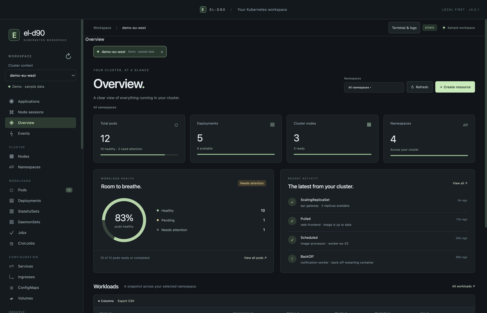
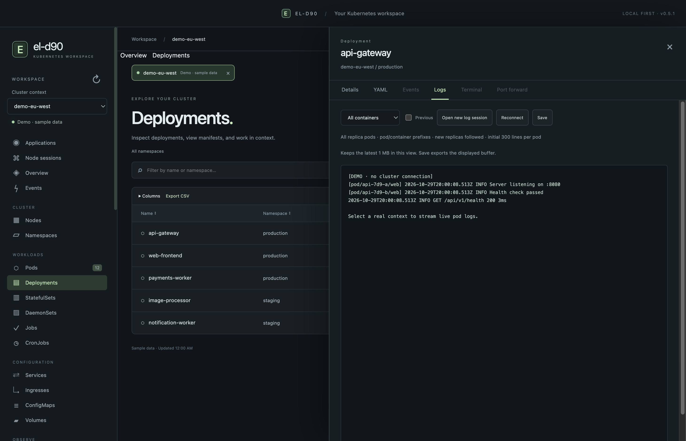

# el-d90

Created and maintained by **[David John (@djohn99)](https://github.com/djohn99)**.

An independent, local Kubernetes desktop workspace for macOS. Open multiple cluster workspaces, select several namespaces, inspect resources, and work with YAML, logs and terminals in context.

## Download and install

**[⬇ Download the latest release for Apple Silicon](https://github.com/djohn99/el-d90/releases/latest)**

[Direct DMG download for 0.5.3](https://github.com/djohn99/el-d90/releases/download/v0.5.3/el-d90-0.5.3-mac-arm64.dmg)

Requires **macOS 13 or later** on an **Apple Silicon Mac**. [Release notes](https://github.com/djohn99/el-d90/releases/tag/v0.5.3) · [All releases](https://github.com/djohn99/el-d90/releases)

1. Download the DMG using the link above.
2. Open the DMG and drag **el-d90** onto the **Applications** shortcut.
3. Eject the disk image, then open **el-d90** from your Applications folder.
4. Install `kubectl` and configure your own kubeconfig and authentication plugins, then select your cluster context in the app. EKS users need a compatible AWS CLI and their own AWS sign-in. Install Helm if you want to manage Helm releases.

Credentials and local profiles are not included in the download.

### If macOS says “el-d90” Not Opened

Until Apple Developer ID signing and notarization are available, macOS may say it could not verify that el-d90 is free of malware. This build is **ad-hoc signed**, not Developer ID signed or Apple notarized.

Only use this exception if you downloaded el-d90 from [this repository’s official releases](https://github.com/djohn99/el-d90/releases) and trust the download. You can verify the DMG with the checksum instructions below.

1. In the warning, click **Done** rather than **Move to Trash**.
2. Open **Apple menu → System Settings → Privacy & Security**.
3. Scroll to **Security** and find the message that el-d90 was blocked.
4. Click **Open Anyway**, authenticate with your Mac password or Touch ID if prompted, then confirm **Open**.
5. You should then be able to launch el-d90 normally from **Applications**.

If the blocked-app message is missing, try opening el-d90 from Applications again, then return to Privacy & Security. Managed Macs may require your administrator’s approval.

This grants an exception for el-d90; you do not need to disable Gatekeeper or other system protections. See [Apple’s instructions for opening a blocked app](https://support.apple.com/guide/mac-help/mh40617/mac).

To verify the download, save the [SHA-256 checksum file](https://github.com/djohn99/el-d90/releases/download/v0.5.3/el-d90-0.5.3-mac-arm64.dmg.sha256) beside the DMG and run this command in that directory:

```sh
shasum -a 256 -c el-d90-0.5.3-mac-arm64.dmg.sha256
```

## Screenshots

Cluster overview with workload health and recent activity:



Deployment inspection with combined replica logs:



*Captured from el-d90 0.5.1 in disconnected demo mode using sample data. No real cluster details or credentials are shown.*

## New in 0.5.3

**0.5.3** adds persistent Kubernetes API reads and watches, AWS SSO account/role discovery and richer resource details. See the [complete release notes](docs/releases/0.5.3.md). Occasional tools are grouped under **Advanced**, collapsed by default; its open/closed preference is remembered.

- **Resource map:** group by namespace, application or node, collapse/expand groups, focus a resource and expand its dependency neighborhood.
- **YAML:** use **Rich editor** for local Monaco editing, **Compare changes** for side-by-side review and **Reset to loaded YAML** to restore the loaded baseline. Local checks and explicitly loaded schema diagnostics complement server Validate. The plain editor remains available.
- **Projects:** create a local named scope across one or more contexts and namespace sets. Combined resources and health retain exact cluster identities and mark partial or unassessed data.
- **App catalog:** browse curated Prometheus, cert-manager and Argo CD charts, review upstream requirements/version/default values, then continue to the existing Helm preview and native confirmation. Browsing does not install anything.
- **Guided form:** read a single YAML document into common-resource fields or explicitly load an available resource schema. Update YAML locally while preserving fields outside the form; stale forms cannot overwrite newer YAML. Multi-document manifests remain supported through the YAML editor.
- **GitOps:** read-only Argo CD Application/AppProject/ApplicationSet and Flux controller/source visibility, including sync/health, revisions, conditions, history and verified managed-resource links. Remote/ambiguous destinations never navigate to a same-named local object. Requires the relevant controllers/APIs and read permissions; the app does not install them automatically.
- **Extensions:** install, update, enable/disable and remove reviewed declarative JSON manifests. SDK v1 adds read-only resource pages, metadata/status details, columns and namespace-scoped map relations. No arbitrary JavaScript, HTML, network calls or commands are permitted. Headlamp plugins are not compatible. See [extension authoring](docs/extensions.md).
- **Connect clusters:** inspect provider/client metadata, preview and import kubeconfig *paths*, run an exact-context/namespace read-only test, then open that cluster. Configured OIDC exec plugins may open their own browser login; provider registration and legacy-to-exec conversion remain external. Tokens, certificates, exec arguments and environment values are not returned to the wizard or copied into app settings.

**Kubernetes read transport:** Resource lists, resource Events, raw API/metrics GETs and live watches use persistent, context-isolated Kubernetes API connections. Exec credentials are cached in memory until refresh is needed, with bounded plugin execution; kubeconfig CA, client certificates, TLS server names, configured proxies and impersonation settings are retained. Lists are paginated and Secret list data remains redacted. Permission failures are reported without switching identities. Terminals, logs, port forwarding, Helm, YAML apply/validation and other mutations retain their existing CLI paths. `EL_D90_KUBE_TRANSPORT=cli` is available as an explicit diagnostic compatibility override; test fixture binaries also use CLI mode unless API mode is explicitly requested.

**AWS SSO / EKS:** Open **Advanced → Connect clusters → AWS SSO → EKS**. Select an AWS CLI profile and region, choose **Sign in with AWS SSO**, complete browser sign-in, then choose a cluster and **Add EKS connection → Open this cluster**. Cluster discovery loads automatically after successful sign-in. If listing is restricted, enter a known cluster name. AWS CLI v2 manages credential caching and `eks get-token`; el-d90 never asks for copied access tokens.

To discover your assignments, choose **Sign in & discover roles**. The app pre-fills a known SSO portal URL/region when available, or you can enter your organization’s AWS access portal `/start` URL and SSO region. Complete browser sign-in first; only then does AWS return your assigned accounts. Choose **AWS account → Assigned role → Use selected role**. A separate named AWS CLI profile is saved for that account/role and clusters load automatically. You can repeat the selection for another role without signing in again while the discovery session is valid. This flow does not change AWS or Kubernetes permissions. OAuth tokens remain in the background process and the private AWS CLI SSO cache, never in the renderer or kubeconfig.

The advanced **Set up a new SSO profile** form remains available for manual setup. Existing profile names and the default profile are never overwritten; configuration changes create a private backup. Existing non-SSO profiles may load EKS clusters using their configured credentials. New EKS kubeconfigs are stored privately in the app profile and loaded immediately; your global kubeconfig/current-context is unchanged. EKS discovery and Kubernetes access depend on the selected role’s existing permissions. See [AWS SSO configuration](https://docs.aws.amazon.com/cli/latest/userguide/cli-configure-sso.html).

Sidebar section headings use bold text; section and Custom API Groups collapse preferences are remembered.

Recent resource workflow improvements:

- ConfigMap Details now show multiline per-key text and labelled binary data, key filtering, copy, add/remove/edit fields and **Review YAML changes**. Editing loads the current manifest; unrelated fields, exact identity and binary values are preserved. Existing YAML drafts are protected. Validate and Apply retain their usual server/native confirmation workflow.
- Secret values have per-key show/hide/copy and edit-to-YAML controls. UTF-8 edits are base64-encoded before staging; other keys stay intact. Revealed values and edit buffers are cleared on panel/tab/context changes. Clipboard writes happen only when Copy is clicked.
- All 31 built-in resource kinds use type-specific detail fields, applicable tabs, workload container status/resources and declared resource references. HPA current metrics, VPA recommendations, storage and RBAC references appear where reported. Custom APIs retain their schema/YAML and available conditions.
- Pods, Nodes, Deployments and Overview render resource rows before optional metrics arrive. Delayed responses stay with their exact cluster/generation. Permission checks are limited to applicable actions. In an isolated fixture with a 1,500 ms metrics delay, first Pod paint improved from 1,790.7 ms to 80.6 ms; this is a controlled rendering result, not a universal cluster speed claim.

AI remains disabled. These additions use el-d90 implementations and the upstream Monaco dependency; no Headlamp implementation code is bundled.

## Features

- Concurrent cluster tabs with independent namespace sets, views and connection state.
- Workloads, networking, storage, RBAC, Events and dynamically discovered APIs/custom resources.
- Resource creation/import, YAML editing, local validation, server dry-run and confirmed apply.
- Secret detail **Reveal decoded values** / **Hide values** controls, with native confirmation and panel-only display. UTF-8 data is decoded; binary data is labelled as base64.
- Dedicated **Autoscaling** navigation for HPA and VPA, with VPA target, update policy and container recommendations when the API/controller is installed and accessible.
- Deployment logs aggregated across replicas, Pod logs and interactive Pod shells.
- General local cluster terminals with multiple terminal/log sessions per cluster. Drag the panel’s top edge to resize; close individual sessions or dismiss the panel.
- Dedicated Cluster page with CPU, memory and Pod capacity rings, requests/limits, worker/control-plane filters and CPU/memory history across all namespaces. Overview retains workload health and recent activity for the selected namespaces.
- Pod and Deployment CPU/memory usage columns, plus a detail Metrics tab with CPU, memory, network and filesystem history, container selection, and CPU/memory request/limit lines. Deployment usage aggregates replicas.
- Deployment, StatefulSet, DaemonSet, Job, CronJob, ReplicaSet and ReplicationController detail Metrics tabs aggregate owned Pods with CPU/memory history, request/limit lines, container selection and the same preset/custom time ranges.
- CronJob history follows recorded Job ownership across runs. Completed or very short Jobs may have missing history depending on scrape timing, metric availability and Prometheus retention.
- Node detail Metrics tab with CPU and memory history, capacity reference lines, and the same preset/custom time ranges. Requires node-exporter; nodes are matched by hostname or node label.
- Chart ranges: 5/30 minutes, 1/2/4/6/24 hours, 7 days, or custom start/end times (up to 31 days, subject to Prometheus retention).
- Prometheus historical charts through the Kubernetes Service proxy. History needs a Prometheus source with cAdvisor and kube-state-metrics; unavailable series are reported explicitly. Current usage columns use the Kubernetes Metrics API.
- Helm repositories, chart search, version-pinned install/upgrade previews, rollback and uninstall.
- Port forwarding, scaling, rollout restart and resource management.
- Declared application topology, editor helpers and opt-in Kubernetes watches.
- Node SSH using existing configuration, and separately confirmed privileged Kubernetes debug sessions.

Features remain subject to the selected cluster’s APIs, RBAC, admission and installed tools. This is an independent project, not affiliated with Lens or Mirantis, and does not claim complete feature parity. AI integration is not enabled.

## Requirements

The current packaged application targets Apple Silicon Macs running macOS 13 or later.

- Install `kubectl` and configure your own kubeconfig and authentication plugins.
- EKS access requires a compatible AWS CLI and your own AWS authentication.
- Install Helm for Helm operations.
- Historical charts require an existing Prometheus service with the appropriate exporters and retention. The app does not install monitoring components.

Credentials and local profiles are not included in source or installers. Each CLI retains its normal authentication and authorization behavior.

## Resource table columns

Use the **⋮ column picker** above a resource table to choose its visible columns. Choices are saved separately by resource type. Pods include usage, restarts, controller, IP, node and QoS; Nodes include usage, disk capacity, pod count, instance type, node group, roles, taints and conditions. Workload, network, storage and access-control tables expose fields appropriate to their APIs. CSV exports include only visible columns.

CPU and memory usage require Metrics API access. Missing samples or permissions show **Unavailable**. Node disk values are ephemeral-storage capacity/allocatable values, not measured disk usage. Node pod counts require listing scheduled, non-terminated Pods across all namespaces.

## Workspace display and configuration

Open **Settings** at the bottom of the sidebar to choose **Dark**, **Light** or **Follow system** and adjust text size. Theme, text size and color changes preview immediately. Choose **Apply settings** to save, or **Cancel** / Escape to restore your saved appearance. In **Smart palette**, pick one main color or preset to generate coordinated light and dark palettes automatically. Generated text and accent colors maintain at least 4.5:1 contrast against the generated surfaces. Open **Advanced customization** to adjust accent, background, sidebar, panels, text and secondary text individually; manual overrides can change that contrast. Light and dark themes keep separate palettes; **Reset colors for this theme** restores its defaults.

Use **Choose kubeconfig files…** or edit the application settings YAML to reference kubeconfig files elsewhere on your Mac:

```yaml
appearance:
  theme: system
  fontSize: 13
kubeconfig:
  paths:
    - ~/.kube/config
    - /absolute/path/to/another-kubeconfig.yaml
```

Save and restart el-d90 to apply changed kubeconfig paths. An empty list uses your existing `KUBECONFIG` environment variable or `~/.kube/config`. The app references those files without copying their credentials or changing their contents. Close active terminal/log/node sessions and Helm operations before restarting.

Sidebar sections can be collapsed with their heading arrows; expanded states persist across launches. Resource navigation uses the sidebar without an extra row of resource-view tabs.

Selected namespaces appear as chips: **×** removes one namespace and **Clear all** returns to all namespaces. Custom definitions are grouped by API group, with shortcuts to their definitions/YAML and discovered resources. The sidebar’s custom API groups provide searchable resource-type navigation.

**Resource map** shows declared ingress, service, workload, Pod and storage relationships. Filter by namespace, kind, application or status; zoom, fit and drag the background to pan. Select a resource to inspect it. The graph displays up to 80 matching resources; narrow the filters for a large cluster. Selector matches do not prove live network traffic.

Oversized resource lists retry through bounded Kubernetes API pages instead of failing at the single-response limit. Unused managed-field metadata is omitted from list rows; full resource YAML is fetched separately. Lists remain bounded at 50,000 resources / 128 MiB per scope; namespace filtering reduces very large queries.

## Run from source

Development requires Node.js/npm and macOS Command Line Tools (`clang`).

```sh
npm ci
npm start
```

Use `npm run demo` for disconnected sample data. `EL_D90_KUBECTL` and `EL_D90_HELM` can select absolute executable paths. `EL_D90_USER_DATA` selects an isolated application profile for development.

## Usage

Choose a kubeconfig context to open a cluster workspace. Open another context for another cluster tab. In **Namespaces**, check multiple namespaces to immediately view their union. Single-resource actions keep the selected object’s exact namespace.

Use **Terminal & logs** to open the session panel. Start local terminals or exact Pod/Deployment log sessions. Drag the top edge up or down; the focused handle also supports arrow keys. **Close session** or a tab’s × stops that session. The panel’s top-right × hides the panel while sessions continue. Disconnecting a cluster or quitting ends its owned processes.

Local terminals start with a private, metadata-only kubeconfig overlay referencing existing configuration. Application initialization leaves existing kubeconfig files and the global current context unchanged. A local shell retains your account permissions; commands you explicitly enter can change files or cluster resources. With several namespaces selected, a terminal starts in the context’s default namespace rather than implicitly issuing commands across all selected namespaces.

Use **Create resource** for arbitrary YAML/JSON, multiple documents and installed custom resources. Complete required fields, validate, then apply. Mutations require native confirmation. Node debug additionally requires explicit consent to create a privileged Pod with host access; the app tracks its identity for cleanup.

Session output and YAML drafts stay in memory. Workspace preferences retain context names, namespace sets, views and historical source settings. A legacy `Harbor` profile directory is retained for compatibility with early development builds.

Namespace checkboxes update the current view immediately and keep the picker open for multiple selections. Click outside a pop-up, resource drawer or settings dialog to dismiss it. Unsaved resource YAML is retained in memory for reopening; dismissing Settings cancels its unsaved appearance preview.

## Troubleshooting and workspace tools

- **Troubleshooting:** inspect Pod crashes, OOM kills, image pull and scheduling failures, stalled replicas, failed Jobs, Node conditions and Warning Events. Findings link to resource details, Events and applicable logs. Partial permissions show incomplete coverage.
- **Logs:** literal or regex search, severity and Pod/container filters, JSON formatting, timestamp toggle and pause/resume display. The bounded buffer retains up to 1 MiB; the viewer renders the last 800 matching lines and Save exports retained matches. Regex runs in a worker with a time limit.
- **Favorites & views:** star resource details or save a named view with its cluster, namespaces, search and label/status filters. References and filters stay locally on this Mac.
- **Global search:** choose up to eight connected clusters and resource types; search names, namespaces, kinds and labels. Results contain metadata only, capped at 500. Resource contents and Secret values are excluded.
- **Charts:** hover for samples, drag across a time window to zoom, reset the zoom, export PNG or CSV, and diagnose missing Metrics API/Prometheus/exporter series. Historical data still depends on your monitoring stack and retention.
- **Workspace safeguards:** assign an environment badge and enable per-cluster read-only mode. The backend blocks new mutations, interactive terminals/input and port forwards; logs and cleanup remain available. Buttons use Kubernetes permission reviews, with exact action checks when full rules are unavailable. Kubernetes remains the authority.
- **Change history:** local metadata for actions through this app, excluding YAML, Helm values, terminal input and output. This is separate from cluster audit logs.
- **Updates & setup:** manually check official GitHub releases and notes, inspect local kubectl/Helm/AWS CLI versions, and follow connection setup guidance. Unsigned updates require manual download and installation.

Large resource tables render a scrolling window of rows; sorting and CSV export cover the complete loaded result. Search is debounced, and obsolete snapshot/chart/search requests are cancelled when changing views or clusters. Existing terminal and log sessions retain their cluster ownership.

## Tests

```sh
npm test
npm run test:desktop-all
```

The backend suite has 209 checks. Twenty-three desktop suites use isolated profiles and offline CLI fixtures. They cover resources/YAML, concurrent workspaces, Helm/history, node access/resource creation, Events, scaling, independent sessions, display/map settings, smart palettes, resource column pickers and cluster/workload metrics charts. The session suite also checks drag/keyboard resizing, panel dismissal and selected-session closure. Workspace-tool checks cover troubleshooting evidence, saved views, metadata search across clusters, safe log filtering, chart hover/zoom/PNG export, 10,000-row virtualization, complete CSV exports, backend read-only enforcement, permission checks, redacted history and update/setup checks.

To test an existing package, set `EL_D90_APP_EXECUTABLE` to its executable path. Automated tests do not require real cluster credentials. Live node SSH, privileged debug and Helm mutations are not established by fixture tests.

## Package for macOS

```sh
npm run package
```

The build compiles the original PTY helper and creates `dist/el-d90-darwin-arm64/el-d90.app`. Apply your chosen signing process before distribution. No Developer ID identity or notarization credentials are included.

The DMG builder creates a Finder window with the app, an arrow and an Applications shortcut:

```sh
python3 -m venv /tmp/el-d90-dmg-tools
/tmp/el-d90-dmg-tools/bin/pip install -r scripts/requirements-dmg.txt
/tmp/el-d90-dmg-tools/bin/python scripts/build-dmg.py \
  --app dist/el-d90-darwin-arm64/el-d90.app
```

The current local release uses an ad-hoc integrity signature, not a Developer ID signature or Apple notarization. macOS may require user security approval. No protections are disabled by the installer.

## Security and provenance

A source review identified and remediated a low-severity historical CSV formula issue. Historical and table exports share formula-prefix neutralization while preserving finite numeric samples. Secret list responses expose only identity metadata, type and key names; full Secret YAML requires confirmation. These controls are not a universal guarantee that Helm manifests, release values, logs or operator-entered content contain no sensitive data.

A dependency advisory check on 2026-10-29 returned no published npm advisories. This is a point-in-time result, not a guarantee against unknown vulnerabilities. Report security concerns through the repository’s private security reporting channel when available; do not publish credentials or cluster details.

See [PROVENANCE.md](PROVENANCE.md) for the bounded source/asset comparison and [THIRD_PARTY_NOTICES.md](THIRD_PARTY_NOTICES.md) for dependency licenses. Local reverse-engineering evidence, live environment records, dependencies, compiled helpers and release outputs are excluded from Git.

## License

Original project source and visual identity are MIT licensed. Dependencies retain their own licenses.

## Author and official builds

**David John ([@djohn99](https://github.com/djohn99))** created and maintains el-d90. The repository is owned by `djohn99`, original source carries David John’s MIT copyright, and future packaged builds show the author credit in **el-d90 → About**.

Download official builds from [this repository’s Releases](https://github.com/djohn99/el-d90/releases). Releases produced by the automated workflow include GitHub build-provenance attestations linking the DMG to this repository, its commit and its workflow. Verify a downloaded automated build with `gh attestation verify <downloaded-file.dmg> --repo djohn99/el-d90`. The manually published 0.5.1 and 0.5.2 installers have no GitHub attestation. The 0.5.2 installer was built and verified locally from tag `v0.5.2` after the GitHub macOS job remained queued; its SHA-256 checksum is included with the release. An attestation establishes build origin; it is separate from Apple Developer ID signing and notarization.

## Automated releases

Pushing a `v*` version tag triggers [Apple Silicon DMG release](.github/workflows/release.yml). The tag must exactly match `package.json`, for example `v0.5.3` for version `0.5.3`. The workflow validates the runner/version, installs locked dependencies, runs backend and packaged desktop checks, ad-hoc signs the app, builds and verifies the drag-to-install DMG, records provenance, and publishes the DMG and SHA-256 checksum. Prerelease versions are marked as prereleases. Existing published release assets are never replaced by reruns.

After committing your next changes:

```sh
npm version patch
# npm updates package.json/package-lock.json and creates the matching commit and tag.
git push origin main --follow-tags
```

The workflow uses GitHub’s temporary `GITHUB_TOKEN`; no personal access token or Apple certificate secret is required for ad-hoc builds. `contents: write` is limited to the publishing job; the build job has provenance permissions. The separate **Run workflow** button builds, tests and retains a downloadable Actions artifact without publishing a release or creating a new version tag. It can be used to validate changes to the pipeline.
